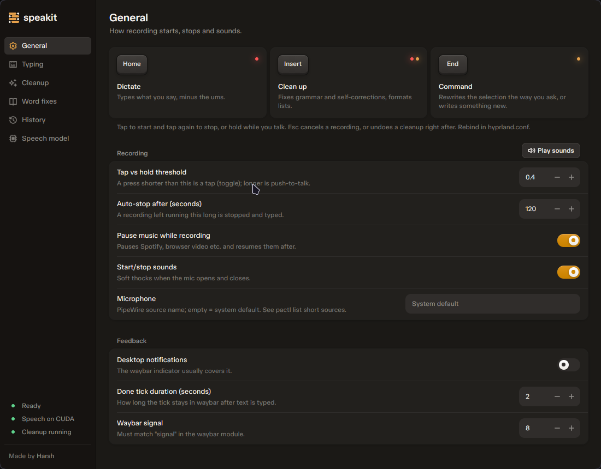
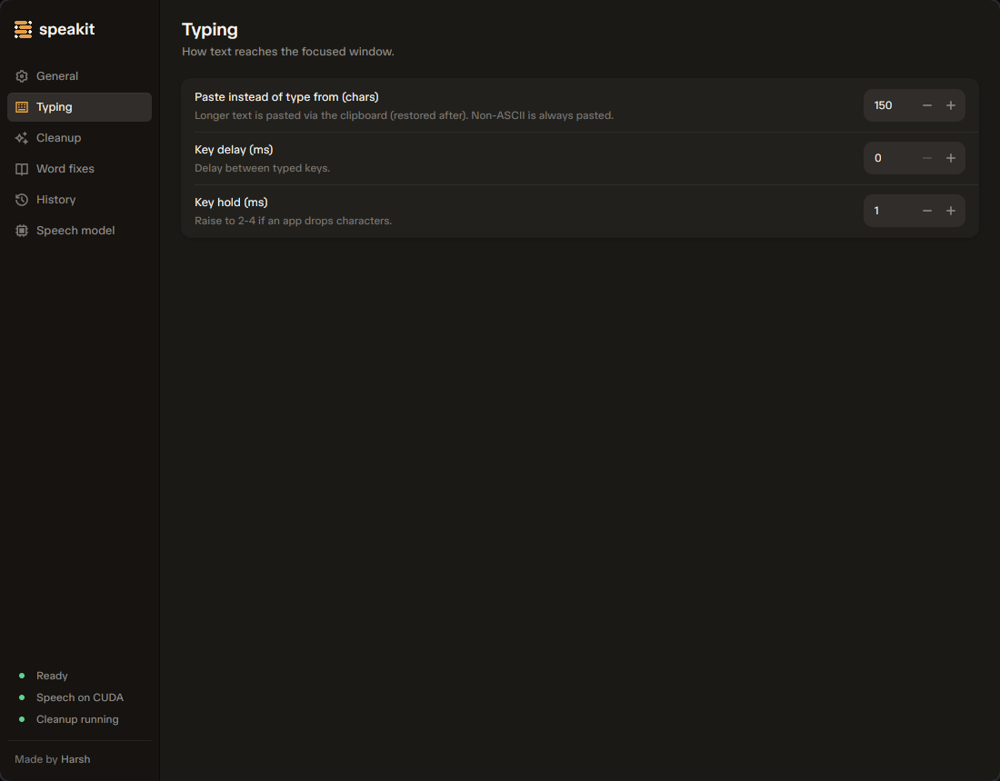
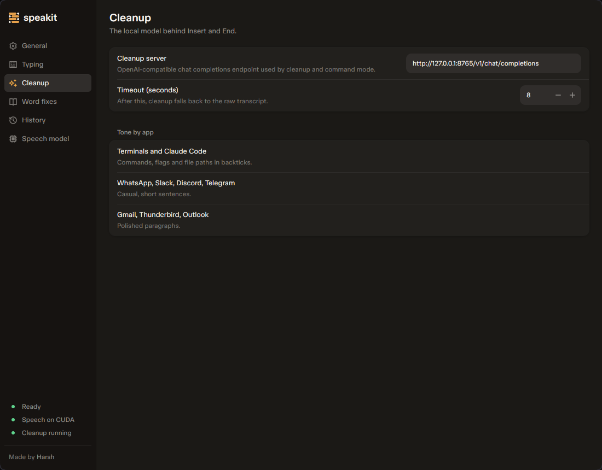
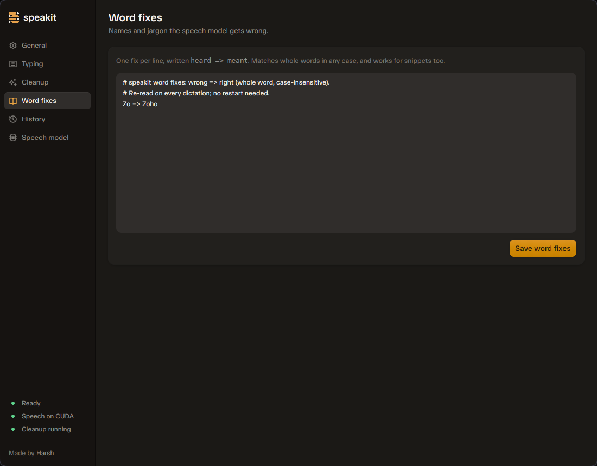
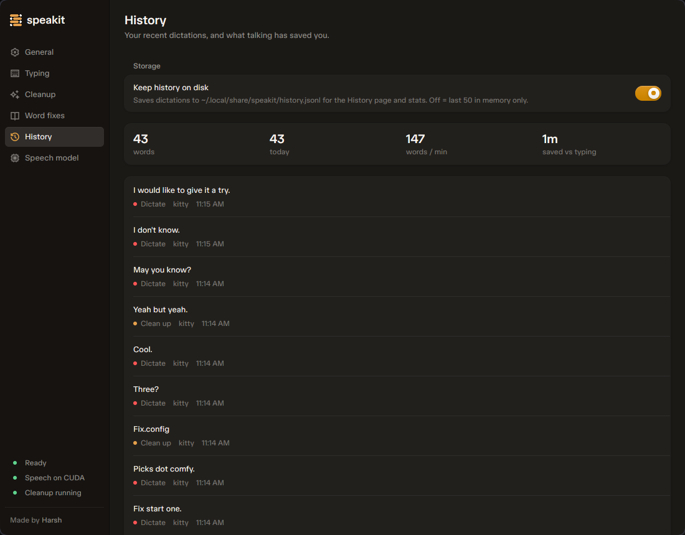
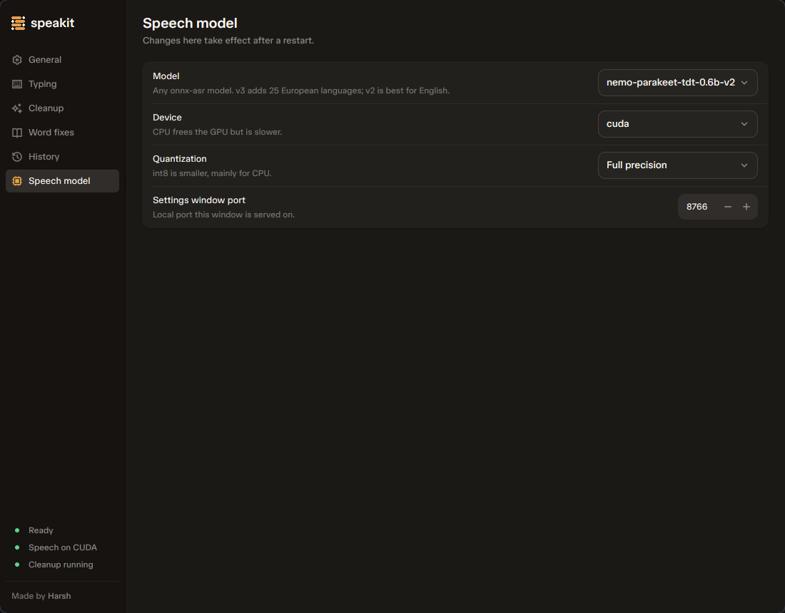

<p align="center">
  
</p>

<h1 align="center">speakit</h1>

<p align="center">
  Local, private voice-to-text for Linux. Press a key, speak, and the text is typed into whatever window has focus.
</p>

<p align="center">
  
</p>

---

speakit is a system-wide dictation tool for Arch Linux and Hyprland. It keeps a
speech model resident on the GPU, records while you hold or toggle a key, and types
the transcript straight into the focused window: a terminal running Claude Code, a
browser text field, a chat app, an editor. An optional local language model cleans
up grammar and formatting, and a command mode rewrites selected text on request.

Nothing leaves the machine. Speech recognition, cleanup, and storage all run locally.

## Contents

- [Features](#features)
- [Key bindings](#key-bindings)
- [The settings app](#the-settings-app)
- [How it works](#how-it-works)
- [Requirements](#requirements)
- [Installation](#installation)
- [Configuration](#configuration)
- [Word fixes and snippets](#word-fixes-and-snippets)
- [Waybar indicator](#waybar-indicator)
- [Privacy and security](#privacy-and-security)
- [Troubleshooting](#troubleshooting)
- [Development](#development)
- [Acknowledgements](#acknowledgements)

## Features

### Dictation

- **Tap or hold.** Tap the key to start and tap again to stop, or hold it while
  speaking and release to finish (push-to-talk). Presses shorter than the tap
  threshold (0.4 s by default) count as taps.
- **Fast.** The model stays loaded in VRAM, so each dictation only pays for
  transcription: tens of milliseconds for a short clip on a CUDA GPU.
- **Accurate English with punctuation.** NVIDIA Parakeet TDT 0.6B v2 by default;
  v3 adds 25 European languages.
- **Filler removal.** Hesitations such as "uh", "um" and "hmm" are dropped,
  along with the commas around them.
- **Auto-stop.** A recording left running stops and types after 120 seconds
  (configurable).

### Cleanup mode

Dictate with the cleanup key and a local LLM (Qwen3-4B-Instruct on llama.cpp)
rewrites the transcript the way you meant to type it:

- fixes punctuation, capitalisation and grammar
- removes false starts and repeated words
- applies spoken self-corrections ("at 3, no, 4" becomes "at 4")
- formats spoken lists as bullet or numbered lists, and separate topics as paragraphs
- obeys spoken formatting commands such as "new paragraph" or "numbered list"

The tone adapts to the focused application: terminals and coding assistants get
commands and paths in backticks, chat apps a casual register, email clients
polished paragraphs. If the LLM is unavailable or its output looks wrong, the raw
transcript is typed instead, so cleanup never loses a dictation.

### Command mode

Select text, press the command key, and say what to do with it: "make this more
polite", "turn this into bullet points", "translate to Hindi". The result replaces
the selection. With nothing selected, command mode writes new text from your
instruction, for example "write a short reply saying I'll be ten minutes late".

### Context awareness for developers

When the focused window is a terminal, speakit finds the working directory of the
program in the foreground (Claude Code, an editor, or the shell) and matches spoken
file names against the files tracked in that git repository:

| You say | speakit types |
|---|---|
| "fix the bug in daemon dot py" | `fix the bug in src/speakit/daemon.py` |
| "update the read me dot md" | `update the README.md` |
| "check vite dot config dot ts" | `check ui/vite.config.ts` |

A name shared by several files is typed as the plain file name. Names that match
no tracked file are left as spoken.

### Recovery

- **Cancel.** Press Esc while recording to discard the recording. Nothing is typed.
- **Revert a cleanup.** Press Esc right after a cleanup dictation, while the done
  indicator is showing, to replace the cleaned text with the raw transcript.

speakit binds Esc only for those moments, so it keeps working normally in every
application the rest of the time.

### Typing that works everywhere

- Text is typed through speakit's own virtual keyboard (kernel uinput), so it
  works in native Wayland apps, XWayland, terminals, browsers and Electron apps.
- Line breaks are sent as Shift+Enter, so chat apps and Claude Code do not
  submit a message halfway through.
- Long text (150+ characters) and non-ASCII text are pasted instead of typed; the
  clipboard is restored afterwards. Terminals receive Ctrl+Shift+V.

### Quality of life

- **Media pause.** Spotify, browser video and other MPRIS players pause while
  you record and resume afterwards.
- **Audio cues.** Soft start and stop sounds confirm that the microphone opened
  and closed. You can replace them with your own files.
- **History and statistics.** Every dictation is saved locally and shown in the
  settings app, along with total words, words today, speaking speed, and time
  saved compared with typing.
- **Waybar indicator.** A status module shows recording, cleanup, command mode,
  processing and done states.

## Key bindings

| Key | Action |
|---|---|
| **Home** | Dictate. Tap to start and stop, or hold while speaking. |
| **Insert** | Dictate with cleanup. Same tap or hold behaviour. |
| **End** | Command mode. Select text first, or nothing to write new text. |
| **Esc** (while recording) | Cancel the recording. |
| **Esc** (right after a cleanup) | Replace the cleaned text with the raw transcript. |

Pressing Insert or End during a recording stops it in that mode. Home, Insert and
End are set in `hyprland.conf` and can be rebound to any key; Esc is managed by
speakit and needs no configuration.

## The settings app

`speakit-toggle settings`, or "speakit settings" in your application launcher,
opens a native settings window built with Rust and gpui. Changes are saved to
`~/.config/speakit/config.toml` and take effect immediately, except speech model
changes, which apply after a restart. The sidebar shows whether the daemon, the
speech model and the cleanup server are running.

<table>
  <tr>
    <td></td>
    <td></td>
  </tr>
  <tr>
    <td align="center"><b>Typing</b>: paste threshold and key timing.</td>
    <td align="center"><b>Cleanup</b>: LLM endpoint, timeout and per-app tone.</td>
  </tr>
  <tr>
    <td></td>
    <td></td>
  </tr>
  <tr>
    <td align="center"><b>Word fixes</b>: corrections for names and jargon.</td>
    <td align="center"><b>History</b>: recent dictations and statistics.</td>
  </tr>
  <tr>
    <td></td>
    <td></td>
  </tr>
  <tr>
    <td align="center"><b>Speech model</b>: model, device and quantisation.</td>
    <td></td>
  </tr>
</table>

If the native app is not installed, the launcher falls back to a React web UI
(`ui/`) served by the daemon and opened in a Chrome app window.

## How it works

```
Hyprland key bind ──► speakit-toggle ──unix socket──► speakitd (daemon)
                      (Rust, ~1 ms)                    ├─ Parakeet ASR model resident in VRAM
                                                       ├─ pw-record: 16 kHz mono WAV
                                                       ├─ transcribe on CUDA (onnx-asr)
                                                       ├─ optional cleanup via llama-server
                                                       ├─ type through its own uinput keyboard
                                                       └─ update the waybar indicator

speakit (settings app) ──HTTP, loopback + token──► speakitd JSON API
```

| Component | Location | Role |
|---|---|---|
| `speakitd` | `src/speakit/` | Python daemon: recording, transcription, cleanup, typing, settings API |
| `speakit-toggle` | `client/` | Rust key-bind client; sends one command to the daemon and exits |
| `speakit` | `app/` | Native settings app (Rust, gpui, gpui-component) |
| `speakit-llm.service` | `systemd/` | llama.cpp server running Qwen3-4B-Instruct Q4 on Vulkan |
| Web UI | `ui/` | Fallback settings interface (React, Vite) |
| Waybar module | `waybar/` | Status indicator script |

Desktop integration happens in-process: Hyprland's IPC socket for the focused
window and key binds, MPRIS over D-Bus for media control, and signals for waybar.
Each of these takes about 1 ms, compared with 40 to 55 ms for spawning `hyprctl`
or `playerctl`.

## Requirements

- Arch Linux (or a derivative) with Hyprland and PipeWire
- An NVIDIA GPU with a driver that supports CUDA 13 for fast transcription. CPU
  works but is slower. No system CUDA toolkit is needed; the CUDA and cuDNN
  libraries come from Python wheels.
- About 3 GB of additional VRAM for the optional cleanup model (Vulkan; can run on
  any GPU)
- [uv](https://docs.astral.sh/uv/) for the Python environment
- Rust (installed by the installer if missing)
- pnpm, optional, only for the web UI fallback

## Installation

```bash
git clone https://github.com/h0i5/speakit.git ~/Desktop/web/speakit
cd ~/Desktop/web/speakit
./install.sh
```

The installer:

1. installs missing system packages (`pipewire`, `wl-clipboard`, `llama-cpp`,
   `ggml-vulkan`, `libnotify`, `rust`)
2. grants your login session access to `/dev/uinput` through a udev `uaccess`
   rule (no `input` group membership)
3. creates the Python environment with `uv sync` and downloads the cleanup model
   (about 2.4 GB)
4. builds and installs `speakit-toggle` and the settings app to `~/.local/bin`
5. installs and starts the `speakit` and `speakit-llm` systemd user services

The speech model downloads on first start. Then add the key bindings to
`~/.config/hypr/hyprland.conf`:

```ini
bind  = , Home,   exec, ~/.local/bin/speakit-toggle press
bindr = , Home,   exec, ~/.local/bin/speakit-toggle release
bind  = , Insert, exec, ~/.local/bin/speakit-toggle press-clean
bindr = , Insert, exec, ~/.local/bin/speakit-toggle release
bind  = , End,    exec, ~/.local/bin/speakit-toggle press-command
bindr = , End,    exec, ~/.local/bin/speakit-toggle release
```

The services start automatically with your graphical session.

> Upgrading from an install that used the `input` group? Re-run `./install.sh`.
> It removes the old rule and your group membership; log out and back in afterwards.

### Command-line interface

```bash
speakit-toggle            # toggle recording
speakit-toggle press      # what the key binds send (also: release, press-clean, press-command)
speakit-toggle cancel     # discard the current recording
speakit-toggle raw        # replace the last cleanup with the raw transcript
speakit-toggle status     # idle | recording
speakit-toggle settings   # open the settings app
```

## Configuration

Settings are read in this order: environment variable, then
`~/.config/speakit/config.toml`, then the default. The settings app writes
`config.toml`; hand edits are fine. Environment variables go in the service file
(`~/.config/systemd/user/speakit.service`, `Environment=...`) and lock the
matching control in the settings app.

| Variable | Default | Description |
|---|---|---|
| `SPEAKIT_HOLD_SECONDS` | `0.4` | Presses shorter than this are taps; longer ones are push-to-talk |
| `SPEAKIT_MAX_RECORD_SECONDS` | `120` | Recordings stop and type after this long |
| `SPEAKIT_PAUSE_MEDIA` | `1` | Pause MPRIS media players while recording |
| `SPEAKIT_SOUNDS` | `1` | Start and stop sounds |
| `SPEAKIT_MIC_TARGET` | system default | PipeWire source name; see `pactl list short sources` |
| `SPEAKIT_PASTE_MIN_CHARS` | `150` | Paste instead of typing from this length |
| `SPEAKIT_KEY_DELAY` | `0` | Delay between typed keys, in ms |
| `SPEAKIT_KEY_HOLD` | `1` | How long each key is held, in ms; raise to 2 to 4 if an app drops characters |
| `SPEAKIT_LLM_URL` | `http://127.0.0.1:8765/v1/chat/completions` | Any OpenAI-compatible chat completions endpoint |
| `SPEAKIT_LLM_TIMEOUT` | `8` | Seconds before cleanup falls back to the raw transcript |
| `SPEAKIT_NOTIFY` | `0` | Desktop notifications |
| `SPEAKIT_DONE_TICK_SECONDS` | `2` | How long the done indicator shows; also the window for reverting a cleanup |
| `SPEAKIT_SAVE_HISTORY` | `1` | Keep dictations on disk for the History page and statistics |
| `SPEAKIT_WAYBAR_SIGNAL` | `8` | Must match `signal` in the waybar module |
| `SPEAKIT_MODEL` | `nemo-parakeet-tdt-0.6b-v2` | Any onnx-asr model; `nemo-parakeet-tdt-0.6b-v3` for 25 languages |
| `SPEAKIT_DEVICE` | `cuda` | `cpu` frees the GPU; CUDA failures fall back to CPU automatically |
| `SPEAKIT_QUANTIZATION` | full precision | `int8` is smaller, mainly useful on CPU |
| `SPEAKIT_UI_PORT` | `8766` | Loopback port of the settings API |
| `SPEAKIT_REPLACEMENTS` | `~/.config/speakit/replacements.txt` | Word fixes file |
| `SPEAKIT_MODEL_DIR` | `~/.cache/speakit/<model>` | Where the speech model is stored |
| `SPEAKIT_SOUND_START`, `SPEAKIT_SOUND_STOP` | built in | Custom cue sound files |

The model, device, quantisation and port settings apply after a restart:
`systemctl --user restart speakit`.

## Word fixes and snippets

For names and jargon the speech model mishears, add `heard => meant` lines to
`~/.config/speakit/replacements.txt`, or edit them on the Word fixes page. Matching
is whole-word and case-insensitive, `#` starts a comment, and the file is re-read
on every dictation, so no restart is needed.

```
Zo => Zoho
S D F S => SDFs
my calendar link => https://cal.com/your-name
```

The right-hand side can be any text, which makes the same file work for snippets:
say the phrase on the left and the full text is typed.

## Waybar indicator

Add the module to your waybar configuration:

```jsonc
"custom/speakit": {
  "exec": "~/Desktop/web/speakit/waybar/speakit.sh",
  "return-type": "json",
  "signal": 8,
  "interval": "once"
}
```

| State | Display |
|---|---|
| Recording | Blinking red dot and `REC` |
| Recording with cleanup | `REC` with a gold sparkle |
| Command mode | `REC` with a gold wand |
| Processing | Hourglass |
| Done | Green tick, hidden after a moment |
| Idle | Hidden |

The daemon signals waybar (`SIGRTMIN+8`) on every state change, so the module
updates instantly. Suggested styles:

```css
#custom-speakit.recording {
  color: #ff5555;
  background-color: #2a1519;
  animation: speakit-blink-red 1.2s infinite;
}

#custom-speakit.processing {
  color: #e5a04b;
  background-color: #251e14;
}

#custom-speakit.done {
  color: #50fa7b;
  background-color: #16241c;
  padding: 3px 16px 3px 12px;
}

@keyframes speakit-blink-red {
  0%, 50%  { color: #ff5555; }
  51%, 100% { color: #4a2026; }
}
```

The glyphs come from Nerd Fonts.

## Privacy and security

- **Fully local.** Audio, transcripts and cleanup never leave the machine. The
  speech and language models are downloaded once and run offline.
- **History is private.** Dictations are stored in
  `~/.local/share/speakit/history.jsonl` with permissions `0600`. Turn off
  "Keep history on disk" to keep only the last 50 in memory.
- **Narrow input access.** speakit only writes to `/dev/uinput`, through an ACL
  granted to the active session. It never reads `/dev/input`, so it cannot see
  your keystrokes.
- **Protected settings API.** The daemon's API listens on loopback only, checks
  the `Host` header to block DNS rebinding, and requires a random per-start token
  stored in a file only your user can read.
- **The audio file is temporary.** Recordings are written to `$XDG_RUNTIME_DIR`
  (tmpfs) and overwritten by the next dictation.

## Troubleshooting

| Symptom | Fix |
|---|---|
| Nothing is typed | No uinput access. `getfacl /dev/uinput` should list `user:$USER:rw-`. Re-run `./install.sh`, then log out and back in. The daemon log reports `no /dev/uinput access` at startup. |
| `no-daemon` from `speakit-toggle` | `systemctl --user status speakit`; logs with `journalctl --user -u speakit -f` |
| Transcription is slow | The model may have loaded on CPU. Check the daemon log for a CUDA error and make sure the NVIDIA driver supports CUDA 13. |
| Cleanup types raw text | The LLM server is down or slow. Check the sidebar status in the settings app and `journalctl --user -u speakit-llm`, or raise the timeout. |
| Wrong microphone | Set the microphone on the General page, or `SPEAKIT_MIC_TARGET`. |
| An app drops characters | Raise Key hold to 2 to 4 ms on the Typing page. |
| File names are not converted | Only works in terminals, inside a git repository, for files that git tracks. |

## Development

```bash
# Python self-checks
cd src
../.venv/bin/python -m speakit.text
../.venv/bin/python -m speakit.polish
../.venv/bin/python -m speakit.history
../.venv/bin/python -m speakit.config

# Settings app
cd app && cargo test --release && cargo build --release
install -m755 target/release/speakit ~/.local/bin/

# Key-bind client
cd client && cargo build --release
install -m755 target/release/speakit-toggle ~/.local/bin/

# Web UI fallback
cd ui && pnpm install && pnpm build

# Apply daemon changes
systemctl --user restart speakit
```

### Project layout

```
src/speakit/
  daemon.py     recording, transcription, typing, key handling
  polish.py     LLM cleanup and command mode prompts
  text.py       filler removal, word fixes, spoken file names
  desktop.py    focused window, terminal directory, clipboard, media, sounds
  native.py     Hyprland IPC, MPRIS over D-Bus, uinput keyboard
  history.py    dictation history and statistics
  server.py     settings JSON API
  config.py     settings schema and config.toml handling
client/         speakit-toggle (Rust)
app/            settings app (Rust, gpui)
ui/             web settings fallback (React)
systemd/        user services and desktop entry
waybar/         status module
```

## Acknowledgements

- [NVIDIA Parakeet TDT](https://huggingface.co/nvidia/parakeet-tdt-0.6b-v2) for speech recognition
- [onnx-asr](https://github.com/istupakov/onnx-asr) and ONNX Runtime for inference
- [llama.cpp](https://github.com/ggml-org/llama.cpp) and [Qwen3](https://huggingface.co/Qwen) for cleanup
- [gpui](https://www.gpui.rs) and [gpui-component](https://github.com/longbridge/gpui-component) for the settings app
- TASA Orbiter typeface (SIL Open Font License)

Made by [Harsh](https://harshiyer.in).
